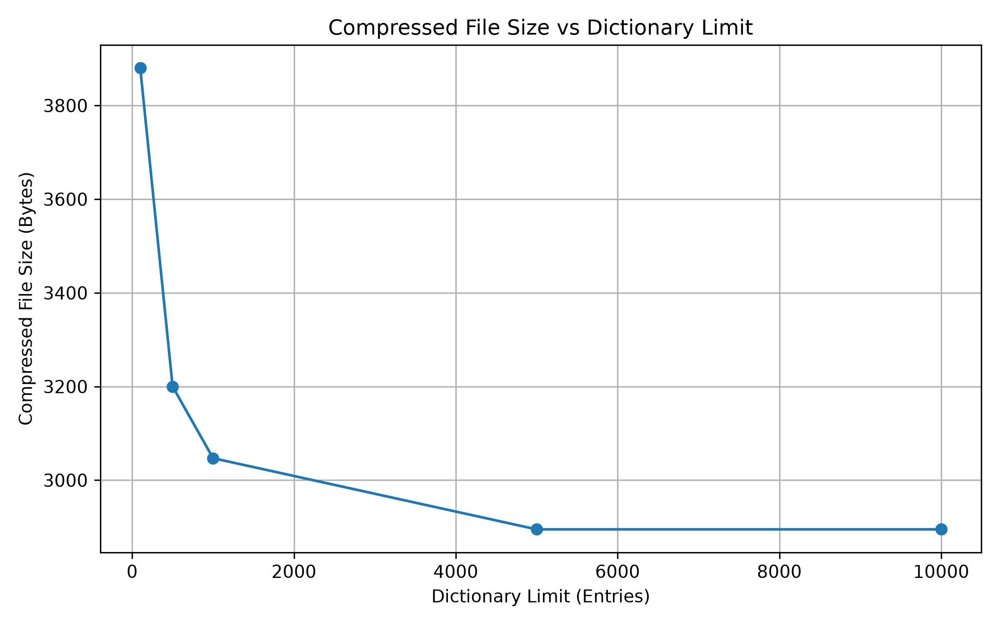
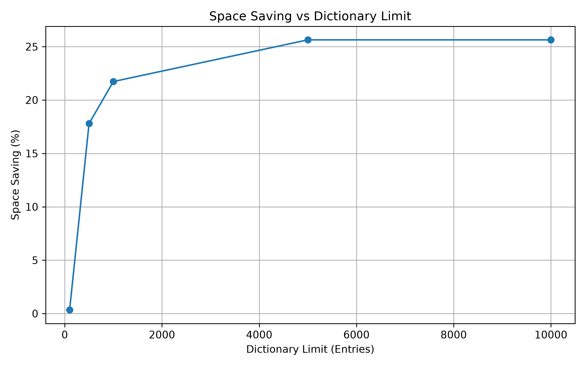
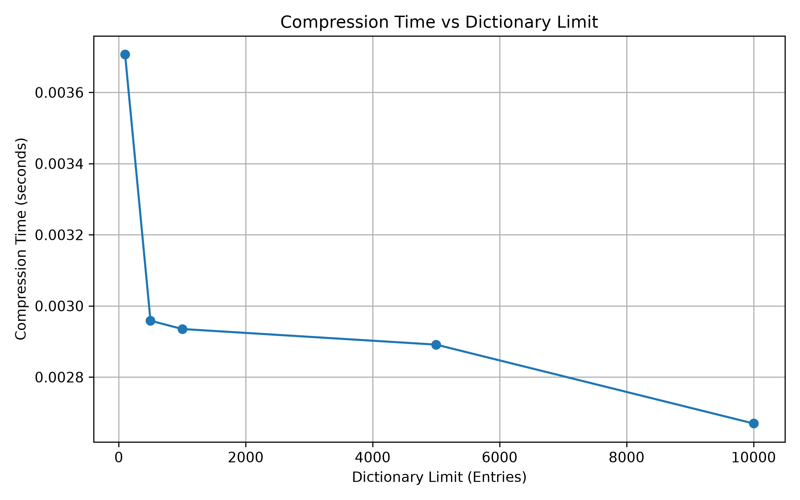

# LZ78 Compression Toolkit

A C++ implementation of the LZ78 lossless compression algorithm with configurable dictionary limits, binary file encoding, decompression verification, and automated performance visualization.

The project explores how dictionary capacity affects compression efficiency, storage requirements, and execution time.

## Overview

LZ78 is a dictionary-based lossless compression algorithm that identifies recurring patterns in input data and represents them using dictionary references and characters.

This toolkit implements LZ78 compression and decompression and evaluates its behavior under multiple dictionary-size configurations.

Instead of assuming that compression always reduces file size, the program compares the generated output with the original input and retains the compressed representation only when it is smaller and passes decompression verification.

## Key Features

- **LZ78 Compression:** Encodes input data using dictionary references and characters.
- **LZ78 Decompression:** Reconstructs the original input from the encoded token stream.
- **Configurable Dictionary Limits:** Evaluates dictionary capacities of 100, 500, 1,000, 5,000, and 10,000 entries.
- **Dictionary Reset Support:** Clears the dictionary when its configured capacity is reached.
- **Bit-Level Encoding:** Uses bit-oriented input and output classes to encode token fields.
- **Decompression Verification:** Compares decompressed data with the original input.
- **Performance Benchmarking:** Records compressed file size, dictionary size, compression time, compression ratio, and space saving.
- **CSV Export:** Saves experimental results to `results.csv`.
- **Automated Visualization:** Generates three performance graphs using Python, Pandas, and Matplotlib.
- **Output Size Safeguard:** Selects a verified compressed representation only when it is smaller than the original input; otherwise, it copies the original input to the final output file.

## Technology Stack

| Technology | Purpose                                                            |
| ---------- | ------------------------------------------------------------------ |
| C++        | Compression, decompression, binary file handling, and benchmarking |
| Python 3   | Performance graph generation                                       |
| Pandas     | Reading experimental results from CSV                              |
| Matplotlib | Generating performance visualizations                              |
| Git        | Version control                                                    |
| GitHub     | Source code hosting and project documentation                      |

## Project Structure

```text
lz78-compression-toolkit/
├── LZ-78.cpp
├── generate_graphs.py
├── input.txt
├── results.csv
├── Graph1_Compressed_File_Size.png
├── Graph2_Space_Saving.png
├── Graph3_Compression_Time.png
├── .gitignore
└── README.md
```

The C++ program also generates binary output files during execution. These generated files are excluded from version control by `.gitignore`.

## How It Works

### 1. Input Processing

The program reads the contents of `input.txt` in binary mode.

Reading the file in binary mode allows the implementation to process byte-oriented input without applying text-mode newline transformations.

### 2. Dictionary-Based Compression

The compressor processes the input and searches for existing patterns in its dictionary.

When a new pattern is encountered, it emits a token containing:

- The index of the existing prefix.
- The next character, when present.
- A flag indicating whether the character exists.
- A reset flag for dictionary-reset operations.

The dictionary stores previously encountered patterns and assigns indices to newly inserted entries.

### 3. Dictionary Capacity Experiments

The program evaluates these dictionary limits:

| Experiment | Dictionary Limit |
| ---------- | ---------------: |
| 1          |      100 entries |
| 2          |      500 entries |
| 3          |    1,000 entries |
| 4          |    5,000 entries |
| 5          |   10,000 entries |

When the dictionary reaches its configured capacity, the implementation emits a reset token and clears the dictionary.

These experiments help examine the relationship between dictionary capacity and compression performance.

### 4. Binary Encoding

The implementation uses custom `BitWriter` and `BitReader` classes to encode and decode token fields at the bit level.

The output file begins with a token count, followed by the encoded token stream.

### 5. Decompression Verification

Each generated compressed file is decompressed and compared with the original input.

A result is marked successful only when the reconstructed string matches the original input.

### 6. Performance Analysis

For each dictionary limit, the program records:

- Original file size.
- Compressed file size.
- Peak dictionary size.
- Compression time.
- Compression ratio.
- Space-saving percentage.
- Decompression verification status.

The measurements are exported to `results.csv`.

### 7. Final Output Selection

The program searches the verified experimental results for the smallest compressed file that is smaller than the original input.

If a suitable result exists, it copies that representation to `final_lz78_output.bin`.

Otherwise, it copies the original input to the same output filename.

This safeguard prevents the final output from being larger than the original input, provided the file-copy operation succeeds.

**Important:** The final output may be the original, uncompressed input. The `.bin` extension alone does not guarantee that the file contains compressed data.

## Performance Metrics

### Compression Ratio

The program calculates compression ratio as:

$begin:math:display$
\\text\{Compression Ratio\} \=
\\frac\{\\text\{Original File Size\}\}
\{\\text\{Compressed File Size\}\}
$end:math:display$

A ratio greater than 1 indicates that the compressed representation is smaller than the original.

### Space Saving

The program calculates space saving as:

$begin:math:display$
\\text\{Space Saving \(\\\%\)\} \=
\\left\(1\-\\frac\{\\text\{Compressed File Size\}\}
\{\\text\{Original File Size\}\}\\right\)\\times100
$end:math:display$

Positive values indicate a reduction in file size, while negative values indicate that the compressed representation is larger.

The metrics describe the generated representation, including its file-format overhead.

### Compression Time

Compression time is measured using C++'s `std::chrono` facilities.

The reported time measures the execution of the compression function, rather than the entire file-processing pipeline.

Consequently, file writing, decompression, and graph generation are not included in this timing measurement.

## Performance Visualizations

The project generates three graphs from `results.csv`.

### Graph 1: Compressed File Size vs Dictionary Limit



This graph compares the sizes of generated compressed files across dictionary configurations.

### Graph 2: Space Saving vs Dictionary Limit



This graph illustrates how the dictionary limit relates to the percentage of storage saved.

### Graph 3: Compression Time vs Dictionary Limit



This graph compares the measured compression execution time across dictionary configurations.

**Note:** The graphs present experimental measurements rather than guaranteed performance improvements. Results depend on the input dataset, implementation, and execution environment.

## Requirements

- A C++ compiler supporting C++17.
- Python 3.
- Pandas.
- Matplotlib.

The C++ program uses standard library facilities and does not require an external C++ compression library.

## Getting Started

### 1. Clone the Repository

```bash
git clone https://github.com/Codewithmanoj-01/lz78-compression-toolkit.git
cd lz78-compression-toolkit
```

### 2. Compile the C++ Program

On macOS or Linux, run:

```bash
g++ -std=c++17 -O2 LZ-78.cpp -o lz78
```

### 3. Prepare the Input

Place your test data in `input.txt`.

The current program expects this filename in its working directory.

The input must be non-empty because the program exits when the file is empty.

### 4. Install Python Dependencies

It is recommended to use a virtual environment.

Create one with:

```bash
python3 -m venv .venv
```

Activate it on macOS or Linux:

```bash
source .venv/bin/activate
```

Install the dependencies:

```bash
python -m pip install pandas matplotlib
```

### 5. Run the Compression Experiments

Execute:

```bash
./lz78
```

The program performs the dictionary-limit experiments, verifies decompression, writes `results.csv`, and generates the Python graph script.

The program then attempts to execute the graph-generation script using Python.

If the graph-generation step fails, check that Python, Pandas, and Matplotlib are installed in the active environment.

### 6. Regenerate the Graphs Independently

After `results.csv` has been generated, you can regenerate the graphs with:

```bash
python generate_graphs.py
```

The graph script expects the CSV file to contain these columns:

- `DictionaryLimit`
- `CompressedSize`
- `SpaceSaving`
- `CompressionTime`

## Example Workflow

```text
input.txt
    |
    v
LZ78 Compression
    |
    v
Dictionary Limit Experiments
    |
    v
Binary Output Generation
    |
    v
Decompression Verification
    |
    v
results.csv
    |
    v
Python Graph Generation
    |
    +--> Compressed File Size Graph
    |
    +--> Space Saving Graph
    |
    +--> Compression Time Graph
```

## Current Limitations

- The program currently reads a fixed input filename rather than accepting command-line arguments.
- The experiment uses a predefined set of dictionary limits.
- Compression performance depends on the input data.
- Compression time currently measures the compression function, not total processing time.
- The binary format writes the token count using the host's native representation, which may limit portability across architectures.
- The decoder should be tested against malformed and truncated files before being used with untrusted input.
- The implementation should undergo additional edge-case testing before being treated as a production-ready compression utility.

## Future Improvements

- Add automated unit and integration tests.
- Introduce a command-line interface for selecting input files and dictionary limits.
- Improve binary-format portability with a defined byte order and format version.
- Add validation for corrupted and malformed compressed files.
- Benchmark multiple datasets and compare results with other compression algorithms.
- Add continuous integration to compile and test the project automatically.
- Separate compression, benchmarking, and visualization into independently testable components.

## Project Goals

This project demonstrates practical implementation and evaluation of a dictionary-based lossless compression algorithm.

It combines algorithm implementation, bit-level file encoding, data integrity verification, performance measurement, CSV-based analysis, and automated visualization in a single workflow.

---

**Author:** Manoj Kumar
**Repository:** [LZ78 Compression Toolkit](https://github.com/Codewithmanoj-01/lz78-compression-toolkit)
